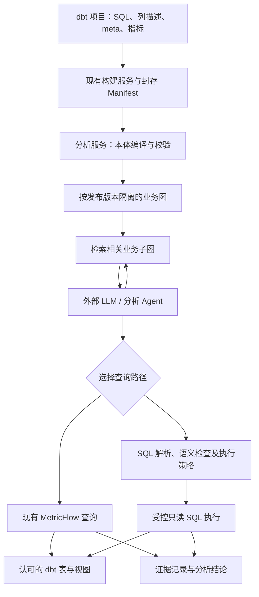

# 基于 dbt 业务本体的混合分析方案

日期：2026-10-26。状态：设计草案，未实施。本文仅定义架构、协议边界和验收场景，不授权代码修改。

## 1. 目标与已确定边界

用户希望：外部 LLM 使用业务关系图理解对象、过程和数据映射；已建模指标通过 MetricFlow 查询；指标和维度不足以回答的问题，生成 SQL 查询 dbt 建模后的 table/view，补充归因调查所需的明细和历史证据。

已确定：不直接开放原始 source 表；图以模型级定义为主，不复制全部订单、用户等实例；现有指标计算链路保留；本次只设计。

本文提出、尚未由用户选择的默认值：第一期单仓库、单数据环境内分析；同一分析固定一个发布上下文；采用属性图数据模型但暂不指定图数据库厂商；外部 Agent 负责推理和会话；业务图与分析编排放在本引擎服务之外的分析服务。SQL 只读访问显式开放的模型列。

不做：业务动作执行、自动修改 dbt 模型、自动补造业务关系、任意原始 SQL 权限、OWL 推理、自动保证因果成立、订单实例知识图谱、跨环境联邦查询。业务事实缺失时明确返回证据不足。

## 2. 方案比较与选择

| 方式 | 优点 | 代价与结论 |
| --- | --- | --- |
| 直接将 Manifest/文档检索给 LLM | 少一个数据库，适合少量模型 | 多跳语义检索和关系校验需自行组织；可作为验证基线 |
| dbt 定义为源、图数据库为派生索引、双查询路径 | 对象与关系可检索，定义与数据转换共同版本化 | 需要编译器、发布一致性与 SQL 执行边界；沿用用户已确定的方向 |
| 将全部业务实例和事实搬进图数据库 | 可直接按实例遍历 | 重复存储、同步、权限和时间一致性成本高，不符合本期目标 |

图数据库不是定义的第二写入入口。定义只在 dbt 项目维护，图可从封存定义重建；产品选型留给技术验证，核查版本隔离、索引、备份、许可证及部署条件后确定，本文不假定具体产品能力。

## 3. 总体结构



职责分工：

- **dbt 工程**：对象和事件的数据投影、历史模型、字段说明、结构化本体定义、质量测试和指标口径。
- **现有引擎服务**：继续构建、封存、部署和提供资源、MetricFlow 查询；增加独立的受控 SQL 执行用例时，不把 Agent 会话、图检索或领域推理装进引擎。
- **分析服务**：解析定义、维护图索引、管理分析发布上下文、检索子图、调用双查询接口和保存证据。初期一个服务内完成，不额外拆成多个微服务。
- **外部 Agent**：拆解问题、提出候选解释、选工具、根据结果修正分析。它不能修改执行策略或自行授权模型。
- **数据仓库**：保存事实数据，执行指标和明细查询；只读账号与数据库权限承担最终访问边界。

## 4. 本体定义：复用 dbt，补充必要语义

### 4.1 定义位置与最小字段

使用 model 的 `config.meta.ontology` 作为自定义命名空间，列的 description/type 继续使用 dbt 原生信息。以下是拟议协议，不是 dbt 官方标准。

| 类别 | 第一期内容 |
| --- | --- |
| 对象/事件/状态 | schema_version、稳定的 type_id、kind、label、description、identity、grain |
| 属性 | 绑定列；复用列描述；必要时补单位、枚举含义、业务时间角色 |
| 关系 | 稳定 relation_id、谓词、目标 type_id、source/target 字段对、基数、可空性 |
| 时间 | 事件时间或 valid_from/valid_to，时区，历史区间采用左闭右开；允许开放结束时间 |
| 数据访问 | 是否申请作为分析模型开放、允许列；服务端批准策略取交集，meta 不授予权限 |
| 指标关联 | 引用现有 MetricFlow metric 标识；不复制指标公式 |

`type_id` 是业务类型身份，dbt unique_id 是模型身份，二者分开。第一期一个业务类型在一个发布内只指定一个主查询模型；历史状态与事件建成显式关联的独立类型，避免同类型多模型选择歧义。

模型粒度以结构化键列表加说明表达；不能仅凭列名或自然语言推导唯一性。属性类型最终由发布时验证过的物理 schema 与模型定义共同确定。缺失或不一致的关键字段阻止该模型发布。

示意：

```yaml
models:
  - name: orders
    description: 一行一张订单
    config:
      meta:
        ontology:
          schema_version: 1
          type_id: commerce.order
          kind: object
          label: 订单
          identity: [order_id]
          grain: [order_id]
          relationships:
            - relation_id: order_placed_by_user
              predicate: placed_by
              target_type: commerce.user
              source_fields: [user_id]
              target_fields: [user_id]
              cardinality: many_to_one
              nullable: false
          time:
            event_time: created_at
          query:
            enabled: true
            columns: [order_id, user_id, created_at, status, amount]
    columns:
      - name: order_id
        description: 订单唯一标识
      - name: user_id
        description: 下单用户标识
```

上述示意中的开启标记仅表示工程作者申请开放；实际可查询范围还须满足服务端策略、调用者权限和仓库授权。

### 4.2 图中保存什么

节点：BusinessType、Property、Model、Metric。业务过程事件也是 BusinessType，以 kind=event 区分；历史状态以 kind=state 区分。

边：HAS_PROPERTY、MAPS_TO_MODEL、BUSINESS_RELATION、MEASURED_BY。每条业务边携带连接字段对、方向、基数和时间规则。Model 保存 Manifest 解析出的 database/schema/alias、物化方式、适配器和字段类型，不让 LLM 根据模型名称猜物理表名。

例：User → placed order → Order → contains → OrderItem → purchases → SKU；InventoryState → describes → SKU；Review → evaluates → Product。订单金额不能在订单与明细的一对多连接后直接求和。

构建血缘单独标记，不转成业务边。业务图允许循环，和 dbt 构建 DAG 的要求不同。搜索限制跳数、结果规模和访问范围，不能把整张图一次塞给 LLM。

### 4.3 业务过程与时间

“发生了支付”建成 PaymentEvent，并绑定 order_id 和 paid_at；“订单当前已支付”只是状态，不替代事件。Submitted、Paid、Shipped、Refunded 等业务过程定义必须说明是可能的转换还是所有实例必须遵守的规则，不能用类型级顺序推断某订单真的发生过事件。

历史状态查询用事件时点匹配有效区间。第一期支持显式字段等值关系，以及等值键加左闭右开有效期匹配；更复杂关系预先建成 dbt 模型或关系表，不在 meta 中嵌入任意 SQL。

库存粒度至少明确 SKU 与仓库/店铺及时间。若只有当前库存或低频快照，查询结果须说明不能恢复完整缺货过程；不从缺失记录推断从未发生。

## 5. 本体编译、发布与失效

读取成功构建的封存 Manifest，提取显式本体定义，结合原生模型、列、指标和物理关系生成标准化图文档。该文档封存为分析服务的派生产物；图数据库仅存索引。

发布校验包括：协议版本、唯一 ID、目标存在、字段和类型匹配、身份键与粒度、基数所需唯一性测试证据、时间字段、指标引用、开放模型和列范围。nullable=false 必须有非空验证，relationships 测试不能代替唯一性验证。必要测试未运行或未通过时不发布对应关系；模型无本体定义可以继续正常 dbt 构建，不自动猜测为业务对象。

Manifest 中的测试定义不是本次通过证据。需要从本次 dbt 调用结果中额外封存运行结果或等价的逐测试验证报告，包含 buildId、测试 unique_id、实际状态及被验证模型。当前项目是否已保存足够结果需在实施时检查，不能只根据日志文本或 build 成功推断。对于索引内必需的唯一性、非空、引用、历史区间不重叠断言，只接受同一次目标构建的 PASS；WARN、SKIP、未选择和无结果都不能通过发布门槛。选择性构建可以继续成功，但缺少这些证据时本体发布保持不可用。

幂等索引键为“仓库＋环境＋buildId＋本体协议版本＋编译器版本”；所有节点和边归属同一索引版本。先导入隔离版本并验证完整性，再将其标记 READY，最后以数据库事务切换分析服务的发布指针；不假定跨服务分布式事务。

索引 PENDING/FAILED 不改变 dbt 构建成功与否，也不替换旧分析版本。分析请求只选择 READY 且物理模型绑定已确认可用的版本。删除与重命名通过新完整版本反映，避免残留旧边；旧版本保留至无活动分析引用后按保留策略清理。重试相同版本不重复创建节点。

**现有项目的重要限制**：buildId 固定定义和配置，不固定物理数据；后续构建会覆盖同 schema 的同名表。图版本固定不意味着数据可回放，也不意味着旧图仍能解释新表。

第一期方案：分析 SQL 仅指向当前可查询发布；记录查询前后物理模型发布代次，若发生切换则废弃本轮证据并重跑。构建开始覆盖该目标之前，由控制层暂停受影响目标的新分析并等待活动查询结束，所有写入该目标的构建必须经过同一协调入口；图 READY 前该目标不恢复分析。若无法保证此协调，不能承诺该模式的一致性，须改用按版本隔离 schema 后再上线。该暂停状态与分析发布指针属于分析控制层，不重定义原有 dbt 构建状态。

这只能约束模型发布变更，不能冻结实时写入的数据。第一期显式声明多查询非同一数据快照，记录执行时间与可获得的数据水位；需要严格可复现的归因，必须使用已冻结分析数据集或仓库原生一致性快照，并另外验证支持情况。

发布准入同时覆盖 MetricFlow 和 SQL，不能只暂停 SQL。目标从 ACTIVE 进入 DRAINING 后拒绝新分析查询，等待两条路径的活动查询结束，再进入 BUILDING；物理模型验证和图索引均完成后才切回 ACTIVE。构建已经覆盖部分模型后失败，或覆盖完成而索引失败，目标保持 UNAVAILABLE，绝不因为旧图还在就恢复旧发布。恢复必须将选定提交重新完整构建、通过必要测试、重建索引后重新激活；或者切换到经验证的隔离物理版本。该恢复是新的显式发布，不是简单回退指针。

## 6. 向 LLM 提供的能力

以下是逻辑工具契约，不是已经存在的 HTTP API；具体路径在实施计划确定。

| 能力 | 输入 | 输出 |
| --- | --- | --- |
| 检索业务定义 | 发布上下文、问题/业务词 | 类型、定义、匹配依据和候选指标 |
| 获取分析子图 | 发布上下文、起点类型、所需信息、跳数预算 | 相关类型、边、连接规则、物理映射、粒度与时间语义 |
| 查询指标 | 固定 buildId、指标、维度、筛选、时间范围 | 复用现有 MetricFlow 结果 |
| 校验并解释 SQL | 发布上下文、候选 SQL、参数、分析目的 | 解析结果、资源清单、计划与拒绝/警告原因 |
| 执行 SQL | 同一上下文、候选 SQL、参数、分析目的 | 再次完整校验后执行，返回结果和证据标识 |

授权后的子图提供给 LLM；隐藏对象、字段不能先返回再期待 LLM 自觉不使用。SQL 执行时重新校验，不能仅信任之前的 explain 或 LLM 声明的所用资源。

检索第一期使用名称、别名、描述及有界关系扩展，暂不引入向量库。业务术语歧义保留候选，不擅自混同。例如下单用户与收货人即使都指向 User 也需要不同关系角色。

## 7. 查询路由与受控 SQL

路由由 Agent 提议：先查看指标是否涵盖目标口径、粒度、时间和筛选。可覆盖则优先 MetricFlow；不可覆盖或需实例/事件证据则走 SQL。已有指标查询报错不等于获得 SQL 绕过权限；先区分表达能力不足、参数错误和数据/权限故障。

SQL 优先查明确开放的 dbt 物理输出模型；允许 CTE、子查询和经过校验的聚合、窗口计算。ephemeral、source、seed、系统表以及未经批准的模型不作为可直接引用资源。incremental 模型按已存在的物理表处理。视图内部可以依赖底层 source，这与用户 SQL 直接访问 source 的禁止边界不同；批准视图时审查其暴露列及定义。

执行服务使用与构建写账号分离的受限只读身份。连接和凭据由固定执行上下文解析，LLM 不能指定。当前服务未提供终端用户身份认证，因此初期只能在受信内部调用链运行；多用户部署必须先由上游提供可信身份与授权策略，不能把 meta 当作身份/权限系统。

两条路径使用同一可信调用者身份、环境和发布上下文，并使用经授权的只读执行身份。分别维护指标允许清单和 SQL 模型/列允许清单：允许某指标不等于允许读取其全部底层明细，允许底层模型也不自动允许所有指标。MetricFlow 请求校验指标、维度、筛选及结果字段；其 EXPLAIN 内容也按策略授权。第一期通过受信网关/服务身份控制入口，Agent 不能直连无鉴权引擎绕过发布和权限检查；若做不到此隔离，不向外部 Agent 开放。现有可信内部调用方式的迁移需单独列入实施计划。

按仓库方言解析 SQL AST，解析 CTE/别名/嵌套查询中的全部物理引用，做表列允许清单和函数策略校验，限定单条只读查询。禁止 DDL/DML、外部读写、任意存储过程、未批准的表函数/UDF及不可解析语法；不能用“以 SELECT 开头”或正则替代。SELECT 也可能触发函数副作用，最终仍依赖受限账号和功能授权。参数值绑定，标识符由解析和已知映射核验。

独立校验声明关系是否被遵循，检查复合键完整性、一对多聚合膨胀和有效期连接。第一期只开放有声明路径的跨模型 JOIN；复杂路径先补充定义或 dbt 模型。不能证明安全聚合时返回修改建议，不宣称 AST 校验能证明所有 SQL 业务正确。

第一期可验证子集进一步限定：非递归 CTE和非相关派生子查询、明确列投影、过滤、分组聚合，以及输出阶段的白名单窗口函数。支持 INNER/LEFT JOIN，条件为已声明的完整等值键，必要时附有效期匹配。携带某粒度的数值跨 JOIN 聚合时，连接侧必须有发布验证的唯一键，或子查询先按连接键聚合成一行；解析器必须追踪列来源与输出粒度，不能证明就拒绝。多对多、CROSS JOIN、递归、相关子查询、集合运算、LATERAL、任意非等值 JOIN 和无法解析的方言扩展均在第一期拒绝。不能支持的分析应改写为受支持查询，或补充一个经过测试的 dbt 模型，不降级为“告警后放行”。该子集仍可验证缺货区间与访问/订单事件等常见场景，但不承诺覆盖任意 SQL。

执行前获取可用的仓库 explain 信息；配置超时、并发、结果行/字节上限和仓库支持的资源预算。LIMIT 仅限制结果，不能视为扫描成本保护。运行限制属于部署配置，初期沿用现有结果上限，超时和并发值在目标仓库验证后确定。

生成 SQL 不复制已有指标公式。必须临时计算时标记为探索性派生量，记录定义、粒度和限制，不冒充正式指标；重复出现的分析需求由人工评估后纳入 dbt/MetricFlow。

“不重复定义正式指标”是 Agent 路由和结果命名规则，不宣称能通过 AST 识别所有语义等价公式。执行器强制区分 MetricFlow 正式指标结果与 SQL 探索结果的来源标签；无法证明口径相同的 SQL 数值不得作为正式指标替代。

## 8. 一次分析与证据格式

例：“上周店铺销售额为什么下降？”

1. 确认销售额指标口径、店铺、对比期和时区，通过 MetricFlow 计算变化及商品贡献。
2. 检索相关子图，得到 SKU、库存历史、价格事件、访问行为、评价的可用路径和数据覆盖范围。
3. 提出少量可检验假设：缺货时长增加、价格调整、流量下降等；没有数据的假设标记暂不能验证。
4. 指标能回答的继续走 MetricFlow；需要时间区间与明细关联的生成受控 SQL。
5. 先按正确粒度计算各来源再连接，防止评价与订单多对多连接放大金额；核对结果完整性和数据覆盖。
6. 输出事实、贡献拆解、候选业务解释和未验证项；因果结论需要另外的识别假设与分析方法。

每份证据至少保存：analysisId、查询标识、buildId、本体索引版本、执行环境、SQL或指标请求、绑定参数（按策略脱敏）、实际引用模型、执行时间、可获得的数据水位、结果列/行数、截断标记、错误/警告及受控结果产物引用。结果产物受访问控制与保留策略管理，不把敏感数据复制到普通日志。

截断样本只能支持样本观察，不能直接推出总体比例；空结果要区分没有事件和没有采集。已保存的证据可审阅，不等于将来重跑一定得到同样数据。

## 9. 对现有项目的影响边界

已核对代码：`platform/manifest_capture.py` 保留 meta；`engines/dbt.py` 返回原生节点并转换语义模型；`application/catalog.py` 读取固定构建的目录和资源；`models/queries.py` 现有四模式及 PREVIEW 不提供任意 SQL 查询。

建议新增分析服务承接本体与会话。引擎服务仅新增独立受控 SQL 请求/响应和执行用例，并复用连接上下文、结果序列化与错误处理，不把 PREVIEW 偷换成任意 SQL，也不要求修改 MetricFlow 或 vendor 源码。现有只读凭据配置和发布协调还需新增，当前代码不具备这些能力。

本体编译可以通过现有目录/资源接口开始验证；规模扩大时评估提供单次封存 Manifest 读取接口，避免逐节点往返。不要解析展示文本恢复模型身份。

## 10. 分阶段交付与验收

| 阶段 | 交付 | 验证方式 |
| --- | --- | --- |
| 1 定义闭环 | 小型电商本体、校验器、版本化图索引与子图查询 | 正确返回订单→明细→SKU路径；缺字段、重名、悬空关系拒绝发布；重建结果一致 |
| 2 数据闭环 | 发布协调、受限只读查询、AST和资源策略、证据记录 | 能查认可模型；直接源表、隐藏列、复合键缺失、写入、危险函数和跨环境引用被拒绝 |
| 3 分析闭环 | 外部 Agent 双路径路由和证据汇总 | 一项标准指标问题、一项库存时段问题、一项证据不足问题均符合预期 |
| 4 扩展 | 更多业务域、术语及性能优化 | 根据真实检索和分析失败样例扩展，不预建全部企业本体 |

核心验收样例：

- 已定义指标查询与当前 MetricFlow 基准结果一致。
- 已知缺货事件样例能在正确有效期识别；只有当前库存时拒绝回推历史。
- 一对多关联不会重复累加订单金额；两条角色不同的用户关系不会混用。
- 发布期间不会把旧图绑定到已被覆盖的新模型；索引失败不暴露半张图。
- 未开放模型或列即使被 LLM 猜中也不能查询；CTE 内隐藏引用同样被检查。
- 未声明关联路径不能执行 JOIN；自然语言关系不自动转成任意 SQL。
- SQL超时、空值、空结果和截断都以证据状态传递，不生成确定性业务结论。
- 同时发生缺货和销量下降只能形成关联证据，不自动输出“缺货造成全部下降”。

## 11. 实施前需确认的部署选择

本方案可先评审，以下项目不妨碍理解架构，但必须在实施与上线前明确：实际图数据库产品；第一期目标仓库与方言；受信调用链及身份来源；是否能够统一协调所有覆盖模型的构建，或需版本化 schema；仓库只读账号和数据权限；是否要求跨查询一致快照。它们是未确认部署条件，不是现有能力或用户已同意的承诺。

## 12. 参考依据

- [dbt meta](https://docs.getdbt.com/reference/resource-configs/meta)：自定义元数据载体。
- [Manifest](https://docs.getdbt.com/reference/artifacts/manifest-json)：模型配置及属性的机器可读产物。
- [dbt 数据测试](https://docs.getdbt.com/docs/build/data-tests)：身份、引用和自定义业务断言。
- [dbt snapshots](https://docs.getdbt.com/docs/build/snapshots)：状态历史及其采集边界。
- [官方 Semantic Layer 与 Text-to-SQL 对比](https://docs.getdbt.com/blog/semantic-layer-vs-text-to-sql-2026)：两类查询互补的公开讨论，不代表本方案已被官方实现。

本方案的自定义协议、组件划分、发布流程、工具契约和验收条件均为针对当前项目的设计建议。
